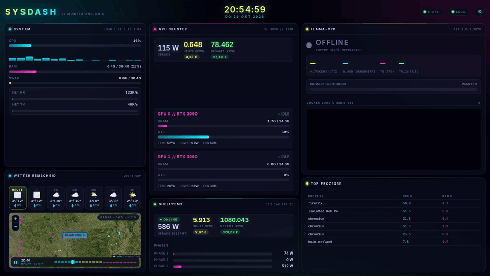
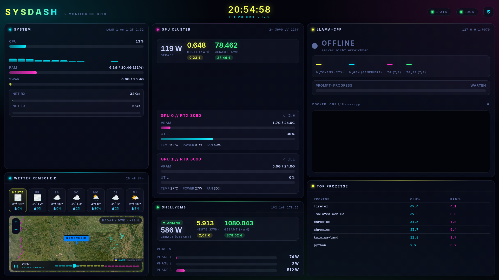

# sysdash

Cyberpunk-System-Dashboard für den 2. Bildschirm: CPU/RAM/GPU/Netz in Echtzeit,
LLM-Telemetrie, Stromverbrauch (GPU + ShellyEM3) und Wetter.

| GIF-Demo | Screenshot |
|:---:|:---:|
|  |  |

## Features

- **FastAPI-Server** (`127.0.0.1:8787`) mit WebSocket-Streams
  - `/ws/stats` — CPU/RAM/Swap/Top-Prozesse, beide GPUs (nvidia-smi), LLM-Slots,
    Netzwerk-Raten, GPU-Energie, ShellyEM3, Wetter (~2 Hz)
  - `/ws/logs` — `journalctl -u llama-cpp -f`, zeilenweise
- **Energie-Integration** — GPU-Leistung wird in kWh integriert und in
  `energy.json` persistiert (pro Tag + gesamt)
- **ShellyEM3** — absolute Zählerwerte vom Stromkasten, Tages-Delta wird
  lokal gehalten und übersteht Neustarts (`shelly.json`)
- **LLM-Monitoring** — Slots, TPS, Decoded, Modell aus der llama.cpp-Server-API
  (`http://127.0.0.1:9070/slots`)
- **Wetter** — Open-Meteo (Remscheid), stündlich neu geladen
- **Frontend** — ein einziges `static/index.html` mit Cyberpunk-Theme

## Installation

```bash
python3 -m venv .venv
.venv/bin/pip install -r requirements.txt
```

## Start

```bash
.venv/bin/python main.py
# oder: ./dashboard.sh
```

Dann `http://127.0.0.1:8787` im Browser öffnen.

## Konfiguration (Umfeldvariablen)

| Variable            | Standard                   | Bedeutung                    |
|---------------------|----------------------------|------------------------------|
| `SYSDASH_PORT`      | `8787`                     | Server-Port                  |
| `SYSDASH_SHELLY`    | `http://192.168.178.21`    | ShellyEM3-Basis-URL          |

Zusätzlich erwartet der Server:

- `nvidia-smi` im PATH (für GPU-Daten)
- systemd-Service `llama-cpp` (für die Logs)
- llama.cpp-Server mit `/slots`-Endpoint auf Port 9070

## Dateien

- `main.py` — Server (FastAPI + WebSocket)
- `static/index.html` — Dashboard-Frontend
- `dashboard.sh` — Start-Wrapper
- `check_display.py` — Hilfskript (Display-Check)
- `energy.json` / `shelly.json` — Laufzeit-Zählerstand (werden zur Laufzeit erstellt, nicht committet)
