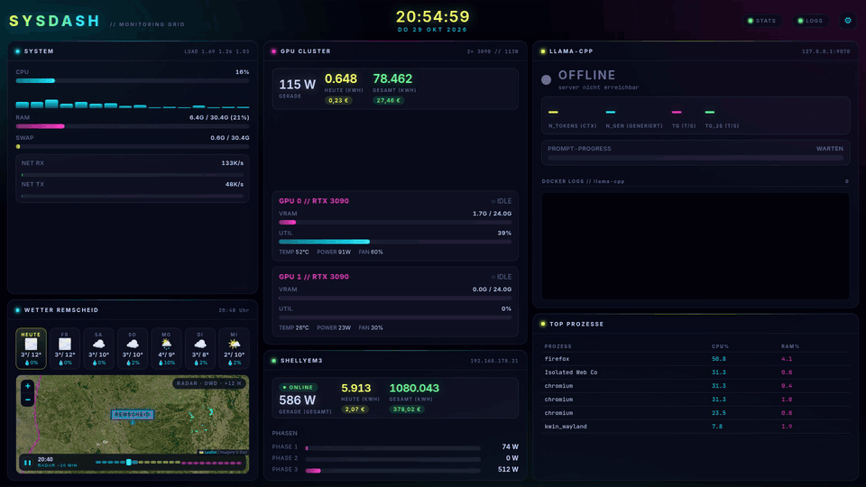
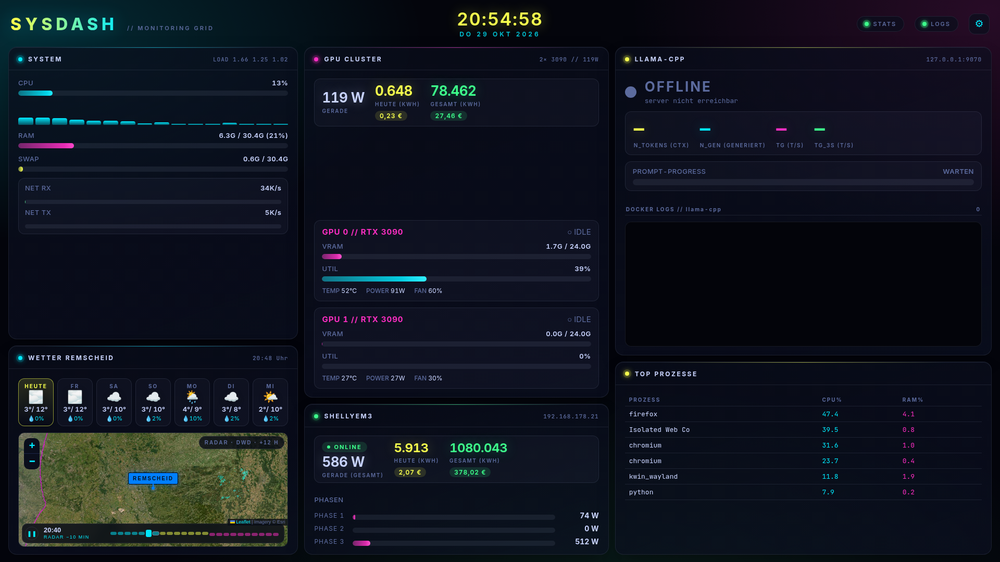

# sysdash

System-Dashboard für den 2. Bildschirm: CPU/RAM/GPU/Netz in Echtzeit,
LLM-Telemetrie, Stromverbrauch (GPU + ShellyEM3), Wetter und Regenradar
mit Zeitraffer bis +12 h.





## Features

- **FastAPI-Server** (`127.0.0.1:8787`) mit WebSocket-Streams
  - `/ws/stats` — CPU/RAM/Swap/Top-Prozesse, beide GPUs (nvidia-smi), LLM-Slots,
    Netzwerk-Raten, GPU-Energie, ShellyEM3, Wetter (~2 Hz)
  - `/ws/logs` — `journalctl -u llama-cpp -f`, zeilenweise (wird nur noch für die
    LLM-Werte ausgewertet, nicht mehr angezeigt)
- **Energie-Integration** — GPU-Leistung wird in kWh integriert und in
  `energy.json` persistiert (pro Tag + gesamt), Kosten mit 0,35 €/kWh
- **ShellyEM3** — absolute Zählerwerte vom Stromkasten, Tages-Delta wird
  lokal gehalten und übersteht Neustarts (`shelly.json`), Leistung je Phase
- **LLM-Monitoring** — Slots, TPS, Decoded, Modell aus der llama.cpp-Server-API
  (`http://127.0.0.1:9070/slots`), Prompt-Progress aus den Logs
- **Kamera** — Livebild einer [Frigate](https://frigate.video)-Kamera im LLAMA-CPP-Panel
  (statt der Docker-Logs). Der Server meldet sich mit einem eigenen Viewer-Benutzer
  bei Frigate an und reicht den go2rtc-MSE-Stream unter `/ws/cam` durch (H.264, ~30 fps,
  ohne Neukodierung; Ersatz bei Browsern ohne MediaSource: MJPEG mit 5 fps unter
  `/api/cam`); Zugang in
  `cam.json` (nicht im Git):
  `{"url": "https://<frigate>:8971", "camera": "<name>", "user": "...", "password": "..."}`.
  Ohne Signal erscheint „KEIN SIGNAL“, die Seite verbindet sich selbst neu.
- **Wetter** — 7-Tage-Vorschau von Open-Meteo (Remscheid), stündlich neu geladen
- **Regenradar-Zeitraffer** (DWD, keylos) als Endlosschleife mit Play/Pause
  und klickbarer Zeitleiste:
  - Ankerpunkt ist die **neueste echte Messung** des DWD (`/api/radar/latest`,
    aus dem `REFERENCE_TIME` der Capabilities, kommt ~5–10 min verzögert)
  - 1 h davor bis dahin: gemessenes Radar (`Radar_rv_product_1x1km_ger`, 10 min, blau)
  - danach bis +2 h: DWD-Nowcast (15 min, gelb)
  - ab der nächsten vollen Stunde bis +12 h: Modell ICON-EU
    (`Icon-eu_reg00625_fd_sl_TOTPREC01H`, stündlich, pink), im selben Farbstil wie das Radar
  - 1,8 s pro Bild, längere Pause bei der letzten Messung und am Ende
  - die magentafarbene Reichweiten-Grenze des Radars wird herausgefiltert
    (sieht sonst wie Extremregen aus)
- **Radar-Proxy** `/api/radar` — der Server holt jedes Bild selbst von
  `maps.dwd.de`: feste Zeit pro Bild (ein DWD-Backend liefert teils Daten vom
  Vortag → wird erkannt und neu versucht), 12 s Timeout, max. 3 parallele
  Requests, In-Memory-Cache
- **Frontend** — ein einziges `static/index.html`, Schriften lokal
  (Inter, JetBrains Mono, DSEG7, VT323, Orbitron)

## Design

Über ⚙ oben rechts (Einstellungen bleiben im Browser gespeichert):

- **Seitenstile** — *Modern* (Standard: Glas-Panels, animierter
  Aurora-Hintergrund, Balken mit Verlauf, weich zählende Zahlen), *Cyberpunk*
  (Neon, Scanlines), *Flat 2D*, *3D Depth*, *btop-Dense*
- **Themes** — Cyberpunk, Terminal-Grün, Dracula, Tokyo Night, Aurora, Paper,
  Solarized Dark/Light oder eigene Farben
- **Schrift, Diagramme (Balken/Sparklines), Animation, Glow, Panel-Ecken** —
  „Ohne“ bei Animation schaltet alle Animationen ab; die System-Einstellung
  „weniger Bewegung“ wird ebenfalls respektiert

## Installation

```bash
python3 -m venv .venv
.venv/bin/pip install -r requirements.txt
```

## Start

```bash
.venv/bin/python main.py
# oder: ./dashboard.sh
```

Dann `http://127.0.0.1:8787` im Browser öffnen.

## Konfiguration (Umfeldvariablen)

| Variable            | Standard                   | Bedeutung                    |
|---------------------|----------------------------|------------------------------|
| `SYSDASH_PORT`      | `8787`                     | Server-Port                  |
| `SYSDASH_SHELLY`    | `http://192.168.178.21`    | ShellyEM3-Basis-URL          |

Zusätzlich erwartet der Server:

- `nvidia-smi` im PATH (für GPU-Daten)
- systemd-Service `llama-cpp` (für die Logs)
- llama.cpp-Server mit `/slots`-Endpoint auf Port 9070
- Internetzugang für Wetter (Open-Meteo), Radar (DWD) und Kartenbasis (Esri)

## Dateien

- `main.py` — Server (FastAPI + WebSocket + Radar-Proxy)
- `static/index.html` — Dashboard-Frontend
- `static/fonts/`, `static/leaflet/` — lokale Schriften und Leaflet (Karte)
- `assets/` — Screenshot und Demo-GIF für dieses README
- `dashboard.sh` — Start-Wrapper
- `check_display.py` — Hilfskript (Display-Check)
- `energy.json` / `shelly.json` — Laufzeit-Zählerstand (werden zur Laufzeit erstellt, nicht committet)
